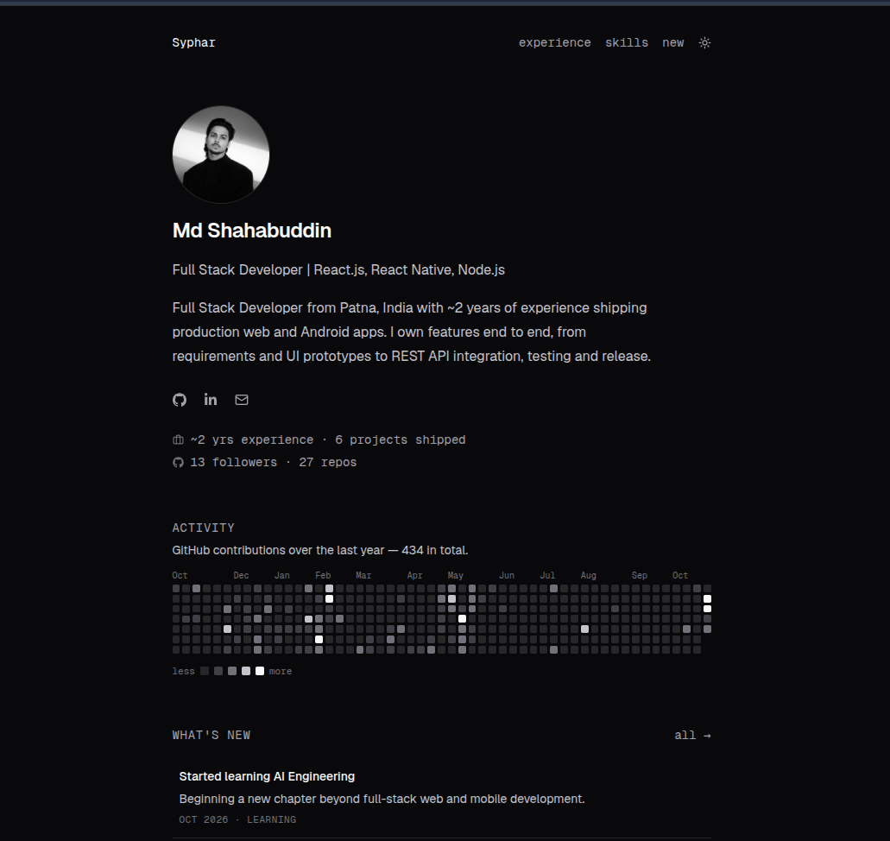

# Syphar — Portfolio

Personal portfolio of **Md Shahabuddin**, a Full Stack Developer building production web and Android apps with React, React Native and Node.js.

**Live:** [shahabuddin.in](https://shahabuddin.in)



## Features

- **Minimal single-column design** with Geist and Geist Mono, a zinc palette and sharp bordered cards.
- **Light and dark mode** with a sun/moon toggle. It follows your system setting on first visit and remembers your choice.
- **Live GitHub activity:** the contribution grid, follower count and repo count load from GitHub.
- **Experience by company:** projects grouped under each company, with tech stack, dates and live links.
- **Skills**, including a "Currently learning" block.
- **What's new page** (`/new`) with a timeline of what I'm learning and shipping.
- Responsive from phone to desktop, with an accessible keyboard focus style.

## Tech stack

- [React 19](https://react.dev) and [Vite](https://vite.dev)
- [Tailwind CSS v4](https://tailwindcss.com)
- [React Router](https://reactrouter.com)
- [React Icons](https://react-icons.github.io/react-icons/)
- Geist fonts via [Fontsource](https://fontsource.org)

## Getting started

Requires Node.js 20 or later.

```bash
git clone https://github.com/xshshahab/portfolio.git
cd portfolio
npm install
npm run dev
```

| Command           | What it does                         |
| ----------------- | ------------------------------------ |
| `npm run dev`     | Start the dev server with hot reload |
| `npm run build`   | Create a production build in `dist/` |
| `npm run preview` | Preview the production build locally |
| `npm run lint`    | Lint the code with oxlint            |

## Project structure

```
src/
├── data.js          # All site content: profile, companies, skills, updates
├── App.jsx          # Layout and routes
├── index.css        # Tailwind setup, fonts and dark-mode colors
├── pages/           # Home and What's new pages
├── components/      # Nav, Hero, Activity, Experience, Skills, Updates, ...
└── hooks/useGithub.js
```

## Customizing

Nearly everything is edited in [`src/data.js`](src/data.js):

- **Profile and links:** `profile`, `socials` and `GITHUB_USER`.
- **Projects:** add to the `companies` list. Each company has a `projects` array.
- **Skills and learning:** `skills` and `learning`.
- **What's new:** add an item to the top of `updates`, and it shows on the home page and `/new`.
- **Avatar:** the default is your GitHub photo. To use your own, add `public/avatar.jpg` and set `avatar: '/avatar.jpg'`.

## Hosting note

The routes (like `/new`) are handled in the browser, so a static host must serve `index.html` for unknown paths. Netlify, Vercel and Cloudflare Pages need one rewrite rule, and Nginx needs `try_files $uri /index.html`.

## Credits

The visual design is inspired by [piyushgarg.dev](https://www.piyushgarg.dev). All content is my own.
